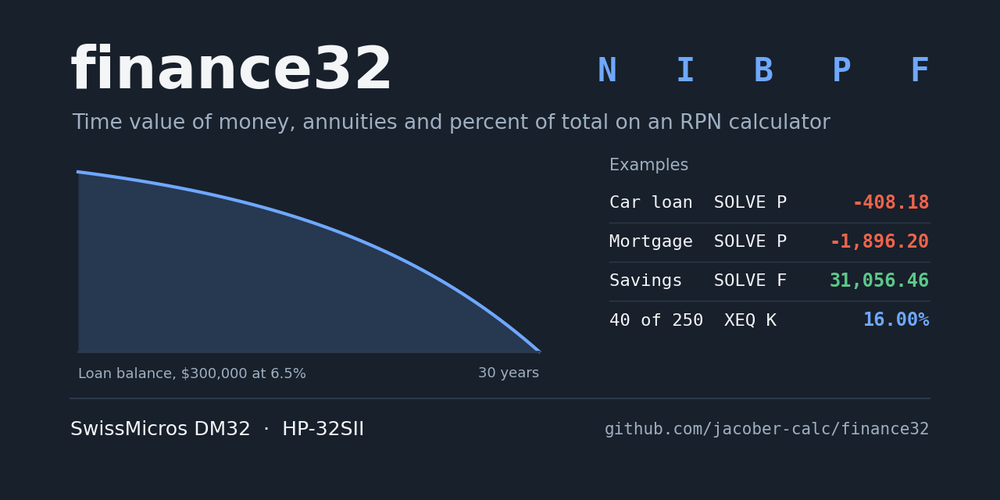
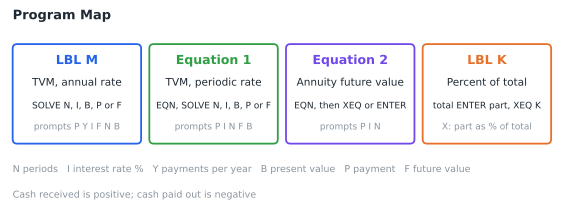
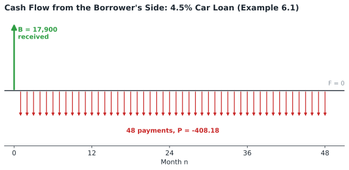
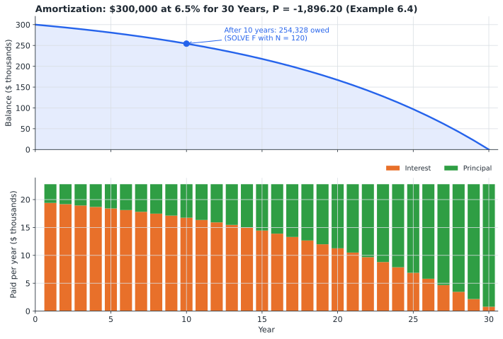
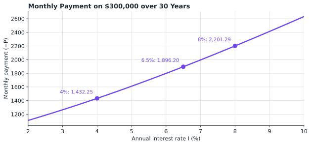
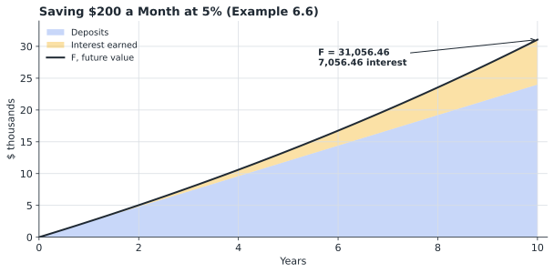

# finance Statefile

## TABLE OF CONTENTS

1. [Introduction](#1-introduction)
2. [Theory of Operations](#2-theory-of-operations)
3. [Variable Definitions](#3-variable-definitions)
4. [Program Descriptions](#4-program-descriptions)
5. [Operating Instructions](#5-operating-instructions)
6. [Example Calculations](#6-example-calculations)
7. [Quick Reference](#7-quick-reference)
8. [Program Listing](#8-program-listing)

---

## 1. INTRODUCTION

This program suite provides time value of money (TVM) calculations for the SwissMicros DM32 calculator. Given any four of the number of periods, interest rate, present value, payment, and future value, the calculator solves for the fifth. The suite also calculates the future value of a series of payments, and what percentage one number is of another.

### 1.1 Purpose

The program enables users to:

- Calculate the payment on a loan or mortgage
- Calculate the interest rate, term, or amount of a loan
- Calculate the balance remaining on a loan after a number of payments
- Calculate the future value of regular savings
- Enter interest as an annual rate (LBL M) or a periodic rate (Equation 1)
- Calculate what percentage a part is of a total

### 1.2 System Requirements

SwissMicros DM32 calculator with RPN operating system. Program requires 9 program steps in 2 labels, plus 2 equations in the Equation list. LBL M is preselected as the SOLVE function (FN= M) in the Statefile.

LBL M and both equations use the DM32's SOLVE and equation functions. All of them, including flag 11 equation prompting and the % function used by LBL K, are also available on the HP-32SII, so the Statefile can be keyed into an HP-32SII as listed.

### 1.3 Install and Download

Copy **FINANCE.d32** to the `/STATE` folder of the DM32's internal USB disk, then load it from the calculator. Instructions are available [via the DM32 User Manual](https://technical.swissmicros.com/dm32/doc/dm32_user_manual.html#_saving_and_loading_a_state).

The Statefile is saved in FIX 6 display format. For money amounts, `[DISP] FIX 2` is often more convenient; the examples in section 6 are shown in FIX 6.

---

## 2. THEORY OF OPERATIONS

### 2.1 Program Map



### 2.2 The TVM Equation

A loan or savings plan has five values:

| Variable | Value |
|----------|-------|
| **N** | Number of payment periods |
| **I** | Interest rate, as a percentage |
| **B** | Beginning balance (present value) |
| **P** | Payment made at the end of each period |
| **F** | Future value (ending balance) |

They are related by the TVM equation, where i is the interest rate per period as a decimal:

```
B + P × (1 − (1 + i)^−N) ÷ i + F × (1 + i)^−N = 0
```

The first term is the money at the start, the second the present value of all the payments, and the third the present value of the amount at the end. Given any four values, SOLVE finds the fifth. In LBL M, Y (payments per year) is a sixth variable, and SOLVE can find it too.

### 2.3 Sign Convention

The sign of B, P, and F shows the direction of the money. **Money received is positive; money paid out is negative.** Every problem can be seen from two sides: a borrower receives the loan (B positive) and pays it back (P negative), while the lender sees the same loan with the signs reversed. A cash-flow diagram shows this with arrows up for money received and down for money paid out:



If a SOLVE result has the wrong sign, or SOLVE cannot find a root, check that the cash amounts have the correct signs.

### 2.4 Annual Rate and Periodic Rate

The two TVM tools differ only in how the interest rate is entered:

| Tool | I is | Periodic rate i |
|------|------|-----------------|
| **LBL M** | Annual rate, %, with Y payments per year | I ÷ Y ÷ 100 |
| **Equation 1** | Rate per period, % | I ÷ 100 |

LBL M is the more convenient for loans and mortgages: enter the annual rate as quoted and Y = 12 for monthly payments. Equation 1 is the TVM equation from the DM32 User Manual (section 19.1), where a 15% annual rate with monthly payments is entered as I = 15 ÷ 12 = 1.25.

LBL M evaluates the same equation, rearranged with i = I ÷ (100·Y):

```
(P × 100 × Y ÷ I − F) × (1 + I ÷ Y ÷ 100)^−N − P × 100 × Y ÷ I − B = 0
```

Line M02 sets flag 11, so the equation at line M03 prompts for each variable in turn, as an equation in the Equation list does. Flag 11 is cleared automatically when SOLVE is done.

### 2.5 Amortization

Solving for F with N set to the number of payments made gives the balance still owed at that point. Repeating this for each year traces the loan's amortization: early payments are mostly interest, later payments mostly principal.



The payment rises with the interest rate, as LBL M shows when solved for P at different values of I:



### 2.6 Annuity Future Value (Equation 2)

Equation 2 calculates the future value of N equal payments P, made at the end of each period, at a periodic rate of (I ÷ N)%:

```
P × ((1 + (I ÷ 100) ÷ N)^N − 1) ÷ ((I ÷ 100) ÷ N)
```

Because the rate per period is I ÷ N, I is the nominal rate for the whole run of N payments. For one year of payments, enter the annual rate as I and the payments per year as N; for example, 12 monthly deposits at 5% a year is I = 5, N = 12. Equation 2 is evaluated rather than solved, and returns a positive result: it is the same amount as LBL M's F for a one-year savings plan, without the sign convention (Example 6.8).

For savings over more than one year, use LBL M:



### 2.7 Percent of Total (LBL K)

LBL K calculates what percentage x is of y:

```
Percent of total = 100 × x ÷ y
```

It uses the DM32's % function, which returns (y × x) ÷ 100 and leaves y unchanged. Taking 1/x before and after % turns this into 100 × x ÷ y. The total stays in the y-register; press `[←]` before keying in the next part to use the same total again (Example 6.9).

---

## 3. VARIABLE DEFINITIONS

| Variable | LBL M | Equation 1 | Equation 2 |
|----------|-------|------------|------------|
| **N** | Number of payments | Number of payments | Number of payments |
| **I** | Annual interest rate, % | Periodic interest rate, % | Nominal rate for the N payments, % |
| **Y** | Payments per year | | |
| **B** | Present value | Present value | |
| **P** | Payment | Payment | Payment |
| **F** | Future value | Future value | |

LBL K uses the stack only.

| Flag | Description |
|------|-------------|
| **11** | Set by LBL M so the equation prompts for each variable; cleared automatically when SOLVE is done |

---

## 4. PROGRAM DESCRIPTIONS

### 4.1 LBL M - TVM Solver, Annual Rate

- **Use:** `[SOLVE]` followed by the unknown, which can be any of the six variables: N, I, Y, B, P, or F. LBL M is selected as the SOLVE function (FN= M) in the Statefile, so it is never run with `[XEQ]`.
- **Prompts:** P?, Y?, I?, F?, N?, B?, in that order, skipping the unknown
- **Output:** The unknown, displayed as, for example, P=

### 4.2 Equation 1 - TVM Equation, Periodic Rate

- **Use:** Open the Equation list with `[EQN]`, show Equation 1, then `[SOLVE]` followed by the unknown variable
- **Prompts:** P?, I?, N?, F?, B?, in that order, skipping the unknown
- **Output:** The unknown

### 4.3 Equation 2 - Annuity Future Value

- **Use:** Open the Equation list with `[EQN]`, show Equation 2, then press `[XEQ]` or `[ENTER]`
- **Prompts:** P?, I?, N?
- **Output:** Future value in the x-register

### 4.4 LBL K - Percent of Total

- **Inputs:** Y: total; X: part
- **Outputs (Stack display from top to bottom):**
  - Y: Total (unchanged)
  - X: Part as a percentage of the total

---

## 5. OPERATING INSTRUCTIONS

### 5.1 Loading the Statefile

Load FINANCE from the Available States list (`[F4]`) or the File menu (section 1.3). FN= M is restored with the State.

### 5.2 Solving with LBL M

```
1. If solving for I, press 1 [STO] [I]           (I must not be 0)
2. Press [SOLVE] and the unknown: [N], [I], [Y], [B], [P] or [F]
3. Key in each prompted value and press [R/S]
   (press [R/S] alone to keep the value shown)
4. Read the result, for example P=-408.182401
```

If another program has been selected for SOLVE since the State was loaded, press `[FN=] [M]` first.

### 5.3 Solving with Equation 1

```
1. If solving for I, press 1 [STO] [I]
2. Press [EQN] and use [▲] [▼] to show Equation 1
3. Press [SOLVE] and the unknown
4. Key in each prompted value and press [R/S]
```

Solving from the Equation list uses the equation shown, not FN= M.

### 5.4 Evaluating Equation 2

```
1. Press [EQN] and use [▲] [▼] to show Equation 2
2. Press [XEQ]
3. Key in P, I and N at the prompts, pressing [R/S] after each
```

### 5.5 Percent of Total

```
1. Key in the total, press [ENTER]
2. Key in the part
3. Press [XEQ] [K]
4. For another part of the same total, press [←] and repeat from step 2
```

---

## 6. EXAMPLE CALCULATIONS

Results are shown in FIX 6, the display format saved in the Statefile. Examples 6.1 to 6.3 are the car-loan example from the DM32 User Manual, section 19.1, worked with LBL M. SOLVE results are iterative, so the last digit may differ slightly.

### 6.1 Loan Payment

**Problem:** A car costing $25,900 is bought with an $8,000 down payment and a 4-year (48-month) loan at 4.5% annual interest, compounded monthly. What is the monthly payment?

**Solution:**

| Keys | Display | Description |
|------|---------|-------------|
| `[SOLVE] [P]` | Y? | Solve for P; prompt for payments per year |
| `12 [R/S]` | I? | Prompt for annual rate |
| `4.5 [R/S]` | F? | Prompt for future value |
| `0 [R/S]` | N? | Prompt for number of payments |
| `48 [R/S]` | B? | Prompt for loan amount |
| `25900 [ENTER] 8000 [-]` | B?17,900.000000 | Amount financed |
| `[R/S]` | P=-408.182401 | Monthly payment |

The payment is negative because, from the borrower's side, it is paid out.

### 6.2 Interest Rate

**Problem:** What annual interest rate would reduce the payment by $20, to $388.18?

**Solution:**

| Keys | Display | Description |
|------|---------|-------------|
| `[SOLVE] [I]` | P?-408.182401 | Solve for I |
| `388.18 [+/-] [R/S]` | Y?12.000000 | New payment |
| `[R/S]` | F?0.000000 | Keep Y |
| `[R/S]` | N?48.000000 | Keep F |
| `[R/S]` | B?17,900.000000 | Keep N |
| `[R/S]` | I=1.979169 | Annual rate, % |

### 6.3 Remaining Balance

**Problem:** At this rate, how much will the borrower still owe after 24 payments?

**Solution:**

| Keys | Display | Description |
|------|---------|-------------|
| `[SOLVE] [F]` | P?-388.180000 | Solve for F |
| `[R/S]` | Y?12.000000 | Keep P |
| `[R/S]` | I?1.979169 | Keep Y |
| `[R/S]` | N?48.000000 | Keep I |
| `24 [R/S]` | B?17,900.000000 | 24 payments made |
| `[R/S]` | F=-9,126.966664 | Balance owed |

The balance is negative: from the borrower's side, it is still to be paid. This agrees with the DM32 User Manual's result of −9,126.97.

### 6.4 Mortgage Payment

**Problem:** Find the monthly payment on a $300,000 mortgage at 6.5% for 30 years.

**Solution:**
```
[SOLVE] [P]
Y?  12     [R/S]
I?  6.5    [R/S]
F?  0      [R/S]
N?  360    [R/S]
B?  300000 [R/S]
```

**Expected Result:** P=-1,896.204070

Solving for F with N = 120 (and the other values kept) gives the balance after 10 years: F=-254,328.379089 (section 2.5).

### 6.5 Number of Payments

**Problem:** A $5,000 credit-card balance is charged 19.99% a year. How many payments of $150 a month will clear it?

**Solution:**
```
[SOLVE] [N]
P?  150 [+/-] [R/S]
Y?  12        [R/S]
I?  19.99     [R/S]
F?  0         [R/S]
B?  5000      [R/S]
```

**Expected Result:** N=49.046683

The result is not a whole number: 49 payments of $150 leave a small balance. Solving for F with N = 49 gives F=-6.942106, so the 50th and final payment is about $7.06 (the $6.94 balance plus one month's interest).

### 6.6 Savings

**Problem:** $200 is deposited at the end of each month into an account paying 5% a year, compounded monthly. How much is in the account after 10 years?

**Solution:**
```
[SOLVE] [F]
P?  200 [+/-] [R/S]
Y?  12        [R/S]
I?  5         [R/S]
N?  120       [R/S]
B?  0         [R/S]
```

**Expected Result:** F=31,056.455889

The deposits are paid into the account, so P is negative and the money taken out at the end, F, is positive. Of the total, $24,000 is deposits and $7,056.46 is interest.

### 6.7 Periodic Rate with Equation 1

**Problem:** $1,000 is deposited at the end of each quarter at 8% a year, compounded quarterly. How much is there after 5 years?

**Solution:** The periodic rate is 8 ÷ 4 = 2% and there are 20 quarters.

```
[EQN]  (show Equation 1)
[SOLVE] [F]
P?  1000 [+/-] [R/S]
I?  2          [R/S]
N?  20         [R/S]
B?  0          [R/S]
```

**Expected Result:** F=24,297.369799

### 6.8 Annuity Future Value with Equation 2

**Problem:** What do 12 monthly deposits of $200 grow to at 5% a year?

**Solution:**
```
[EQN]  (show Equation 2)
[XEQ]
P?  200 [R/S]
I?  5   [R/S]
N?  12  [R/S]
```

**Expected Result:** 2,455.771098

LBL M gives the same amount, with the sign convention, for P = −200, Y = 12, I = 5, N = 12, B = 0: F=2,455.771098.

### 6.9 Percent of Total

**Problem:** $40 of a $250 budget is spent on fuel. What percentage is that? And what percentage is $62.50?

**Solution:**

| Keys | Display | Description |
|------|---------|-------------|
| `250 [ENTER]` | 250.000000 | Total |
| `40 [XEQ] [K]` | 16.000000 | 40 is 16% of 250 |
| `[←]` | 0.000000 | Clears X and disables stack lift; 250 stays in Y |
| `62.5 [XEQ] [K]` | 25.000000 | 62.50 is 25% of 250 |

LBL K leaves the total in the y-register. Pressing `[←]` before the next part keeps the new part from lifting the stack, so the same total is used again.

---

## 7. QUICK REFERENCE

### 7.1 Program Summary

| Tool | Function | How | Prompts | Output |
|------|----------|-----|---------|--------|
| **LBL M** | TVM, annual rate | `[SOLVE]` N, I, Y, B, P or F | P, Y, I, F, N, B | The unknown |
| **Equation 1** | TVM, periodic rate | `[EQN]`, `[SOLVE]` N, I, B, P or F | P, I, N, F, B | The unknown |
| **Equation 2** | Annuity future value | `[EQN]`, `[XEQ]` | P, I, N | X: future value |
| **LBL K** | Percent of total | total `[ENTER]` part `[XEQ] [K]` | None | Y: total, X: percent |

### 7.2 Important Notes

- Money received is positive; money paid out is negative. B, P and F must have the signs that match the problem
- I must not be 0, or the TVM equations stop with DIVIDE BY 0; store 1 in I before solving for I
- In LBL M, I is the annual rate and Y the number of payments per year; in Equation 1, I is the rate per period
- Payments are made at the end of each period
- LBL M is used only with SOLVE, which can solve it for any of its six variables; SOLVE in Calculator mode uses FN= M, while SOLVE with the Equation list open uses the equation shown
- If FN= has been changed by another program, press `[FN=] [M]` before solving
- A fractional N means the last payment is smaller than the others (Example 6.5)
- LBL K stops with DIVIDE BY 0 if the part or the total is 0
- After LBL K, press `[←]` before keying in another part against the same total
- The DM32 also has % (x% of y) and %CHG (percentage change from y to x) built in

---

## 8. PROGRAM LISTING

The complete program listing is provided below. Program steps are shown in standard DM32 RPN format with label-relative line numbers, as displayed on the calculator. The DM32 does not generate checksums.

### LBL M - TVM Solver, Annual Rate

```
M01  LBL M                                     TVM, annual rate. SOLVE program (FN= M).
M02  SF 11                                     Enables equation prompting.
M03  (P×100×Y÷I-F)×(1+I÷Y÷100)^-N-P×100×Y÷I-B  TVM equation; zero at the solution. Clears flag 11.
M04  RTN                                       Returns the equation's value in X.
```

### LBL K - Percent of Total

```
K01  LBL K                                     Percent of total. Y: total, X: part.
K02  1/x                                       1 ÷ part.
K03  %                                         Total × (1 ÷ part) ÷ 100; Y keeps total.
K04  1/x                                       Part as a percent of total.
K05  RTN                                       Done.
```

### Equation List

```
1  P×100×(1-(1+I÷100)^-N)÷I+F×(1+I÷100)^-N+B      TVM equation, periodic rate
2  P×((1+(I÷100)÷N)^N-1)÷((I÷100)÷N)              Annuity future value
```

---

## Disclaimer

This program suite is provided as-is for educational and personal use. Results depend on the inputs and assumptions entered, and lenders may calculate interest, fees and rounding differently. It is not a substitute for professional financial advice or a lender's official figures.

### By jacober-calc for SwissMicros DM32

> - [SwissMicros Website](https://www.swissmicros.com)
> - [DM32 product page](https://www.swissmicros.com/en/products/dm32)
> - [SwissMicros full products page](https://www.swissmicros.com/en/shop)
> - [DM32 Online User Manual](https://technical.swissmicros.com/dm32/doc/dm32_user_manual.html)
> - [SwissMicros Calculator Forum](https://forum.swissmicros.com/index.php)
